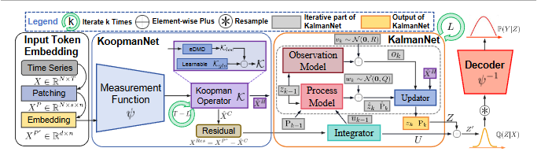
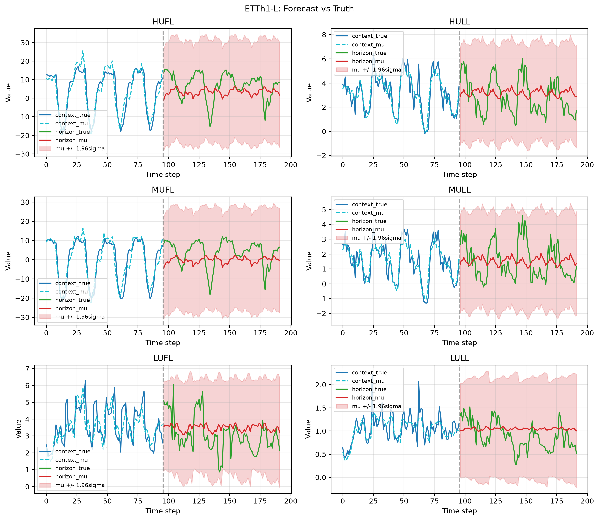
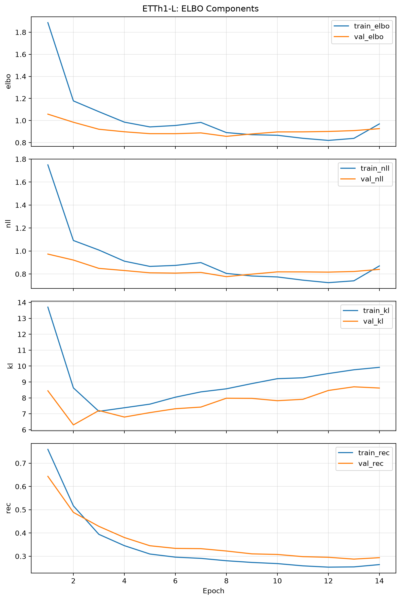
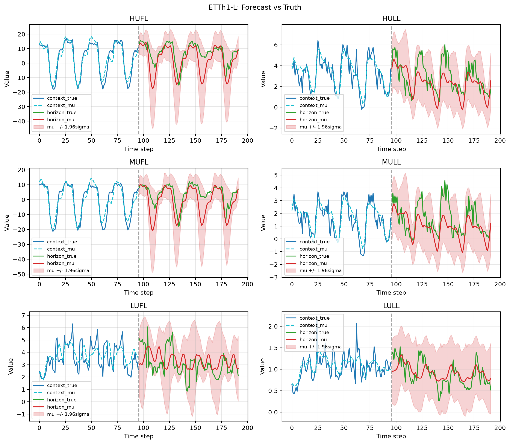
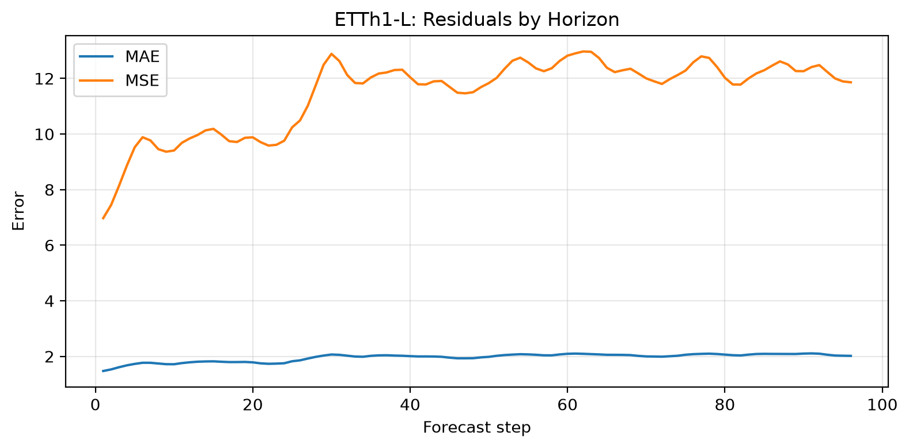

5 chapters

- Intro (last)

	- Problem statement

	- Lit rev

	- Chapter outline

- Prelims

	- All theory we need to introduce methodology

	- Koopman(small summary of idea if easy then break down why useful to us, Koopman operator etc etc)

	- Integrator 

 	- Kalman

	- VAE 

	- MAYBE: Other models

- K2-model

	- What s this model, what are we actually doing here (model specific stuff)

	- Architecture

	- Pre processing (Prepare for model)

	- All stuff we need to implement to make model work

- Results + Experiments

	- Libraries etc etc

	- Preprocessing (Data cleaning) talk about format

	- Hyper parameter tuning what we use show some graphs

	- Actual results and experiments

	- MAYBE: Other models

	- Ablations

* Conclusion 

  * Conclusion (Summary of what we did and what main results were)
  * Offer recommendation
  * Limitations
  * Future work

# Introduction

## Problem Statement

Probabilistic time-series forecasting becomes difficult when the underlying process is nonlinear, noisy, and long-range dependent. In these settings, a forecasting model must do more than produce a point estimate: it must preserve uncertainty, remain stable over long horizons, and avoid compounding error as it rolls forward in time.

The K2VAE paper addresses this by combining three ideas that are individually useful but more powerful together:

1. A variational autoencoder that learns a probabilistic latent representation.
2. A Koopman-inspired linearisation step that makes the latent temporal dynamics easier to model.
3. A KalmanNet-style refinement mechanism that improves the latent state estimate and models process uncertainty.

The core question for this project is whether that combination produces a forecasting model that is meaningfully better than the state-of-the-art baselines reported in the paper on long-horizon probabilistic forecasting tasks, especially when the data contain nonlinear structure, multivariate interactions, and forecast drift. The project is therefore not just about reproducing the paper’s architecture; it is about testing whether the architectural choices give a real forecasting advantage.

## Literature Review

Autoencoders (AEs) compress high-dimensional inputs into a lower-dimensional latent space, but that latent space is usually not structured for sampling or prediction. Variational autoencoders (VAEs) fix this by adding a probabilistic prior and optimising the Evidence Lower Bound (ELBO), which is the part of the K2VAE setup that makes the patch embeddings usable as a generative forecasting representation rather than just a deterministic feature vector [@hinton2006reducing; @kingma2014vae].

VAEs alone do not model temporal evolution, so sequential extensions such as Deep State-Space Models (DSSMs), the Deep Kalman Filter (DKF), and the Kalman Variational Autoencoder (KVAE) add latent transitions and learned observation models for time-series forecasting [@krishnan2015deep; @fraccaro2017disentangled]. Their limitation is that recurrent latent dynamics can still blur the state representation and weaken long-horizon stability [@klushyn2021latent].

That is where K2VAE differs. It keeps the probabilistic latent representation, but replaces the purely recurrent transition with a Koopman-inspired evolution step and a learned KalmanNet refinement stage [@k2vae2025; @kalmannet2021]. Koopman theory is useful here because it offers a way to represent nonlinear dynamics through approximately linear evolution in a learned observable space, and K2VAE uses a measurement function to map embedded patches into that space before KoopmanNet propagates them forward [@koopman2021modern].

The measurement function is therefore not just another projection layer. It defines the observable space in which the latent dynamics are expected to behave more linearly, so it is the bridge between the patch embeddings and the Koopman operator [@k2vae2025].

The Kalman side of the architecture is equally important. Classical Kalman filtering alternates between prediction and update, and K2VAE preserves that recursive structure while learning the correction step from data instead of assuming a closed-form system model [@kalman1960new; @jazwinski2007stochastic; @kalmannet2021].

KalmanNet is the part that makes this filtering stage adaptive: it learns how to adjust the predicted latent state from the incoming observation while still following the predict-update logic that makes Kalman-style estimation stable and interpretable [@kalmannet2021].

Patching then makes the whole pipeline tractable by shortening the input sequence into local chunks before embedding, which reduces sequence length while preserving local structure [@k2vae2025]. In combination, the patching, Koopman-style evolution, KalmanNet refinement, and VAE objective are what make K2VAE a distinct forecasting model rather than just another VAE for time series.

Should we add something on transformers here?

## Chapter Outline

The remainder of this thesis is structured to progressively develop a theoretical understanding of, implement, and evaluate the proposed architecture. Chapter 2 establishes the core mathematical foundations, detailing Koopman theory, Variational Autoencoders, the idea behind transformers and the Kalman-based state estimation. Building upon these principles, Chapter 3 details the methodology and practical implementation of the K$^2$VAE framework, illustrating how these individual components are integrated into a cohesive pipeline alongside data preprocessing and training objectives. Chapter 4 presents the experimental setup and evaluates the model against baseline approaches, offering both quantitative performance metrics and qualitative analyses of its point estimates and probabilistic confidence intervals through visualisations. Finally, Chapter 5 summarizes the core findings, evaluates the fulfillment of the research objectives, and outlines current limitations alongside potential avenues for future work.

# Preliminaries

## Koopman Theory

Time series forecasting is often difficult because the underlying dynamics are noisy, complex, and often nonlinear, as shown by the following state transition function $f$ that maps the current state $x_k$ to the next state $x_{k+1}$:

$$
x_{k+1} = f(x_k)
$$

The issue arises as our prediction horizon grows, resulting in compounding error and drift. Koopman theory provides a way to linearise the dynamics by mapping the finite-dimensional nonlinear state space into a higher infinite-dimensional space where the evolution is linear, which is characterised via a measurement function. This is achieved through the Koopman operator, which acts on observable functions of the state rather than the state itself [@koopman2021modern]:

$$
\psi(x_{k+1}) = \psi(f(x_k)) = \mathcal{K} \circ \psi(x_k)
$$ {#eq-koopman-operator}

The advantage of the Koopman operator is that it allows us to model the system's evolution linearly in our transformed space, even if our original system is nonlinear. As a result, we can use linear techniques to predict more stable and accurate forecasts over longer horizons. 

A key challenge when applying Koopman theory is that the true Koopman operator is infinite-dimensional, necessitating a finite-dimensional approximation. Measurement functions act as observables that extract specific properties from the system's state. Manually defining a finite set of these functions to perfectly linearise complex dynamics is notoriously difficult. Therefore, rather than relying on fixed basis functions, we use a parameterised neural network to jointly learn the optimal measurement function $\psi$ and the Koopman operator $\mathcal{K}$ directly from the data [@koopman2021modern]. This allows the model to learn the optimal transformation and apply it to the raw patches, mapping them into a latent measurement space. By linearising the latent dynamics, we establish a structured, predictable environment that makes subsequent state estimation and uncertainty modeling mathematically tractable:

$$
X^{P*} = \psi(X^{P'})
$$ {#eq-koopman-measurement}

To apply our linear transition rule during training, we utilize extended Dynamic Mode Decomposition (eDMD) to learn the Koopman operator $\mathcal{K}$ from the transformed latent states [@koopman2021modern]. Given our projected latent states or tokens $X^{P*}$ as well as a sequence of mapped temporal data, we separate the sequence into two matrices. These matrices represent the past and the future (shifted by one time step) and are used to learn the linear transition rule in the latent space. The past matrix $X_{back}^{P*}$ contains all but the last token, while the future matrix $X_{fore}^{P*}$ contains all but the first token:

$$
X_{back}^{P*} = [x_1^{P*}, x_2^{P*}, \dots, x_{n-1}^{P*}]
$$

$$
X_{fore}^{P*} = [x_2^{P*}, x_3^{P*}, \dots, x_n^{P*}]
$$

From this, we can extract the local Koopman operator $\mathcal{K}_{loc}$ that best maps the past to the future in the latent space by computing the Moore-Penrose pseudoinverse of the past matrix and multiplying it by the future matrix, which is equivalent to solving a least-squares problem:

$$
\mathcal{K}_{loc} = X_{fore}^{P*} (X_{back}^{P*})^\dagger
$$ {#eq-koopman-local}

This local Koopman operator $\mathcal{K}_{loc}$ is used to capture the local transition rule in the current measurement space; however, relying solely on this can result in numerical instability and incorrect convergence. To address this, we introduce a global Koopman operator $\mathcal{K}_{glo}$ that is learned across all training sequences. To ensure mathematical stability and prevent values from exploding early in training, this global matrix is initialized as an orthogonal matrix using Singular Value Decomposition (SVD). This global operator captures the overall dynamics of the system and provides a stabilizing influence on the local operator. The final transition rule is then a combination of both local and global operators, allowing for more robust and accurate long-horizon forecasting [@k2vae2025]:

$$
\mathcal{K} = \mathcal{K}_{loc} + \mathcal{K}_{glo}
$$ {#eq-koopman-combined}

Consequently, while the Koopman operator $\mathcal{K}$ allows us to forecast longer horizons with greater stability and accuracy without the compounding error that arises from nonlinear dynamics, there exists an inherent bias that is displayed from our residual error between the predicted and actual future states. To address this, additional components of our K$^2$VAE model are introduced, including an integrator to process nonlinear residuals and a KalmanNet-style refinement mechanism to improve the latent state estimate and model process uncertainty.

## Kalman Filter

The Kalman filter is a recursive algorithm that estimates the state of a dynamic system from noisy observations. It assumes the underlying process it is modeling is a linear state space model that alternates between a process model and an observation model [@kalman1960new].

The process model describes how the system (hidden state) evolves over discrete time steps.
$$
x_k = A x_{k-1} + B u_k + w_k, \qquad w_k \sim \mathcal{N}(0, Q)
$$ {#eq-kf-process}
$x_k$ is the state vector at time step $k$, $A$ is the state transition matrix (The underlying dynamics of a system), $B$ is the control input matrix (The effect of control inputs on the system), $u_k$ is the control input (The external input to the system), and $w_k$ is the process noise, which is assumed to be Gaussian with zero mean and covariance $Q$.

The observation model relates this hidden state to the noisy observations actually observed.
$$
o_k = H x_k + v_k, \qquad v_k \sim \mathcal{N}(0, R)
$$ {#eq-kf-observation}
$o_k$ is the observation vector at time step $k$, $H$ is the observation matrix (The relationship between the hidden state and the observed measurements, helps map state space into observation space), and $v_k$ is the observation noise, which is also assumed to be Gaussian with zero mean and covariance $R$. 

Making use of these two models at each time step, the Kalman filter executes a prediction step (using the process model) and an update step (using the observation model) to refine its estimate of the hidden state.

The prediction step uses the process model to predict the next state and its uncertainty based on the previous state estimate.

$$
\hat{x}_k = A x_{k-1} + B u_k
$$ {#eq-kf-predict-state}

$$
\hat{P}_k = A P_{k-1} A^\top + Q
$$ {#eq-kf-predict-cov}

$\hat{x}_k$  is the state estimate and $\hat{P}_k$ is the uncertainty (covariance) of the state estimate.

We then use the observation model to correct our state estimate based on the new observation $o_k$ and how much we trust prediction against how much we trust the observation. This is called the Kalman gain $K_k$. Which is computed as follows:
$$
K_k = \hat{P}_k H^\top \left( H \hat{P}_k H^\top + R \right)^{-1}
$$ {#eq-kf-gain}

The Kalman gain is the ratio of the uncertainty between the prediction step $\hat{P}_k$ and the observation noise $R$. The $H$ is used to map the state space into observation space so the covariance matrices can be compared. The Kalman gain is then used to update the state estimate and its uncertainty, taking us from our predicted ($\hat{x}_k$) state to our corrected ($x_k$) state estimate:
$$
x_k = \hat{x}_k + K_k \left( o_k - H \hat{x}_k \right)
$$ {#eq-kf-update-state}

$$
P_k = \left(I - K_k H\right) \hat{P}_k
$$ {#eq-kf-update-cov}

 The term. $o_k - H \hat{x}_k$ is the innovation (the residual). This is the discrepancy between the actual observation and the predicted observation. When this difference is large our predicted state and our observation are not in agreement. If this difference is small then our predicted state and our observation are in agreement. A $K_k$ close to 1 indicates that we trust our observation more as our prediction is uncertain thus upweight the innovation's importance, while a $K_k$ close to 0 indicates that we trust our prediction more as our observation is noisy and downweight our innovation's importance. After this we then update our uncertainty $P_k$ purely based on the observation matrix and the kalman gain to reflect the new information gained from the observation.

The extension to the kalman filter to handle non linear systems is through the koopman operator and koopman theory. We also make use of KalmanNet, a neural network-based extension of the Kalman filter that learns the desired matrices $A$, $B$, $H$, $Q$, and $R$ from data, allowing it to adapt to complex and nonlinear dynamics [@kalmannet2021]. This is particularly useful in our context, where the underlying system may not adhere to the strict linear assumptions of the traditional Kalman filter.

## Transformer (Encoder Based Vanilla)

A transformer is a deep learning architecture that has revolutionized the field of natural language processing [@vaswani2017attention] and has also been applied to time-series forecasting [@nie2023patchtst]. It is based on the self-attention mechanism, which allows the model to weigh the importance of different parts of the input sequence when making predictions. This is particularly useful for time-series data, where the relationships between different time steps can be complex and non-linear. 

Given a sequence of n input token embeddings $X \in \mathbb{R}^{n \times d}$, the transformer computes three matrices through linear transformations: the query $Q$, the key $K$, and the value $V$ [@vaswani2017attention]:
$$
Q = XW^Q, \quad K = XW^K, \quad V = XW^V
$$ {#eq-transformer-qkv}

$X$ is the input sequence of token embeddings, and $W^Q$, $W^K$, and $W^V$ are learnable weight matrices. Each token calculates a weighted average of the values $V$ based on the similarity between its query $Q$ and the keys $K$ of all other tokens. This is done using the scaled dot-product attention mechanism and allows the model to relate tokens to each other regardless of their position in the sequence. The attention scores for each token are computed as follows:
$$
\text{Attention}(Q, K, V) = \text{softmax}\left(\frac{QK^\top}{\sqrt{d_k}}\right)V
$$ {#eq-transformer-attention}

Transformers make use of multi-head attention, which allows the model to jointly evaluate information from different representation subspaces. Each head computes its own attention scores and outputs, which are then concatenated and linearly transformed to produce the final output. This enables the model to capture various aspects of the input sequence simultaneously. This is done via the following equation [@vaswani2017attention]:
$$
\text{MultiHead}(Q, K, V) = \text{Concat}(\text{head}_1, \ldots, \text{head}_h)W^O
$$ {#eq-transformer-multihead}
$W^O$ is a learnable weight matrix that projects the concatenated outputs of all heads back into the original embedding space. 

We then use a position wise feedforward neural network to further process the output of the multi-head attention mechanism. This feedforward network consists of two linear transformations with a ReLU activation in between, applied independently to each position in the sequence [@vaswani2017attention]:

$$
\mathrm{FFN}(x) = \underbrace{\max(0,\, xW_1 + b_1)}_{\text{ReLU}}\,W_2 + b_2
$$ {#eq-transformer-ffn}
$W_1$ and $W_2$ are learnable weight matrices, and $b_1$ and $b_2$ are learnable bias vectors. The feedforward network allows the model to capture complex relationships and interactions within a single token embedding (whereas attention captures dependencies between token embeddings).

Both the multihead attention and the feedforward network are wrapped in residual connections and layer normalization, which help stabilize training and improve convergence.

Since attention treats the sequence as an unordered set, order information is injected separately, typically via a fixed positional encoding added to the input embeddings before the first layer [@vaswani2017attention]. Stacking $N$ such layers, with no causal masking and no decoder cross-attention, gives the encoder-only variant used here: a bidirectional token mixer mapping $\mathbb{R}^{n\times d} \to \mathbb{R}^{n\times d}$ that captures both local and global dependencies across the input sequence of token embeddings. K$^2$VAE makes use of a transformer encoder to process the left of nonlinearity that koopman does not capture. We call this the Integrator.

## Variational Autoencoders

While standard autoencoders compress high-dimensional data into a lower-dimensional latent space, they are inherently deterministic and lack the ability to model uncertainty in the latent representation [@hinton2006reducing]. The encoder maps inputs to exact point estimates in the latent space rather than probabilistic distributions, resulting in disjoint and arbitrary predictions between points [@doersch2016tutorial]. Variational Autoencoders (VAEs) address this by introducing a probabilistic framework in which the encoder maps inputs to a probability distribution over a continuous latent variable $Z$. This latent variable forces the model to learn a structured and smooth representation of the data, allowing for improved sampling and interpolation. 

In our probabilistic time-series forecasting context, we aim to accurately model the conditional distribution of future observations $Y$, given an observed context window $X$. This ultimately requires finding the true posterior distribution $\mathbb{P}(Z|X)$, which is often intractable. VAEs approximate this true posterior with a variational distribution $\mathbb{Q}(Z|X)$, which is parameterized by the encoder. The VAE framework minimizes the Evidence Lower Bound (ELBO) loss to maximize the likelihood of the observed data while minimizing the divergence between the approximate and true posterior distributions [@kingma2014vae]:

$$
\mathcal{L}_{ELBO} = -\mathbb{E}[\log \mathbb{P}(Y|Z, X)] + D_{KL}(\mathbb{Q}(Z|X) || \mathbb{P}(Z|X))
$$ {#eq-vae-elbo}

This evidence lower bound consists of two terms: the reconstruction loss, which measures how well the model can reconstruct the observed data from the latent representation, and the Kullback-Leibler (KL) divergence, which regularizes the latent space by encouraging the approximate posterior to be close to our selected prior distribution. This forces the approximate posterior to remain smooth and continuous, which is crucial for generating coherent and realistic future predictions. By optimizing the ELBO, we can learn a latent representation that captures the underlying structure of the time-series data while also providing a measure of uncertainty in our predictions.

When attempting to optimize this objective, we encounter a challenge: we must sample the latent variable $Z$ from the encoder's predicted distribution $\mathbb{Q}(Z|X)$, which is a stochastic operation that is not differentiable. To address this, we employ the reparameterization trick, which allows us to express the sampling operation as a deterministic function of the encoder's parameters and a separate source of randomness [@kingma2014vae]. This enables us to backpropagate gradients through the sampling process and optimize the model using standard gradient-based methods:

$$
Z = \mu + \sigma \odot \epsilon, \quad \epsilon \sim \mathcal{N}(0, I)
$$ {#eq-vae-reparam}

Rather than a standard neural network encoder and decoder architecture, we use a KoopmanNet, an Integrator, and a KalmanNet to form our encoder [@k2vae2025]. This projects the input time-series into a latent measurement space, processes the nonlinear residuals, and refines the latent state estimate, returning an approximate posterior distribution. The decoder acts as an inverse measurement function, mapping the latent representation back to the original observation space. This allows us to generate future predictions while also providing a measure of uncertainty in our forecasts.

# K2VAE

This chapter will make use of the theory and concepts introduced in the preliminaries to describe the K2VAE model. We will discuss its architecture, how the different components work and are integrated. We will also discuss the pre-processing steps required to prepare the data for input into the model, as well as the training objectives and loss functions used to optimize the model's performance.

## Pre-processing

The pipeline below is applied to all datasets assessed within this work. We have selected two of the original paper datasets in order to compare with their benchmarks. These datasets have all been pre-cleaned and prepared by the original authors and we have only extracted them. These are ETTh-L as well as Exchange-S. We will also be evaluating the model on two of our own datasets namely Wind-L and Congestion-S. The datasets themselves will be explained in more detail in the results and experiments section.

The K2VAE model treats Probabilistic Time Series Forecasting (PTSF) as a conditional generative task. Given a multivariate context series:

$$
X = [x_1, x_2, \dots, x_T] \in \mathbb{R}^{N \times T}
$$ {#eq-k2vae-context}

the objective is to model the conditional distribution over the forecasting horizon

$$
Y = [x_{T+1}, x_{T+2}, \dots, x_{T+L}] \in \mathbb{R}^{N \times L}, \qquad P(Y \mid X)
$$ {#eq-k2vae-horizon}

where $N$ is the number of variables, $T$ the context length, and $L$ the forecasting horizon.

The series is split into three sets, namely the training set ($p_\text{train}$), the validation set ($p_\text{val}$) and the test set ($p_\text{test}$). These three sets are split as in to keep temporal order and thus have not been shuffled in order to preserve the nature of the time series. We have used a split of 0.70, 0.15 and 0.15 respectively. We then apply standardisation to the training data. The same standardisation values are then applied to the validation and test sets in order to prevent any leakage.

A single training instance is formed by a sliding window of length $T + L$ applied across the standardised time series ($\tilde{x}$), one step at a time offset by i:

$$
X^{(i)} = [\tilde{x}_i, \dots, \tilde{x}_{i+T-1}], \qquad
Y^{(i)} = [\tilde{x}_{i+T}, \dots, \tilde{x}_{i+T+L-1}]
$$ {#eq-k2vae-window}
Where the number of windows for some sequence M = $\text{length(M)} - T - L + 1 $

Each context window $X^{(i)}$ is then divided into $n$ non-overlapping patches of size $s$:

$$
X \in \mathbb{R}^{N \times T} \;\longrightarrow\; X^P \in \mathbb{R}^{N \times s \times n}, \qquad s = T / n
$$ {#eq-k2vae-patch}

so that a single patch $x_i^P \in \mathbb{R}^{N \times s}$ holds every variable over a contiguous block of $s$ time steps. It is worth separating the two senses in which the data is windowed here: consecutive sliding windows overlap heavily, as they advance one time step at a time, whereas the patches within any single window are disjoint. Patching is a pure reshape, so $T$ must be divisible by $s$. The horizon carries the same divisibility requirement through $m = L / s$. This is purely a count of the latent tokens the model rolls forward rather than an operation applied to $Y$ itself. We need $m$ to determine the dimensionality for the integrator. $Y$ remains in its raw temporal layout so that the predictive likelihood can be evaluated directly against it. Both conditions are checked when a dataset is loaded so that an incompatible $(T, L, s)$ configuration fails at the entry point rather than silently mis-shaping a tensor deeper in the pipeline. These two counts matter beyond the preprocessing stage, as every subsequent component operates over $n$ context tokens and $m$ horizon tokens rather than over the $T$ and $L$ raw time steps.

Each patch is then flattened across both variables and within-patch time, collapsing its $N \times s$ values into a single vector. The resulting $\mathbb{R}^{(N \times s) \times n}$ matrix is then mapped to an embedding of dimension $d$ by one linear projection applied identically to all $n$ patches:

$$
X^{P'} = \mathrm{Projection}\big(\mathrm{Flatten}(X^P)\big) \in \mathbb{R}^{d \times n}
$$ {#eq-k2vae-patch-embed}

Flattening across the variable axis before projecting is a deliberate design choice. Channel-independent models patch and project each variable separately, whereas treating the multivariate patch as a single token forces the projection to fuse the variables, allowing cross-variable interaction to be modelled implicitly during the state transition that follows [@k2vae2025]. This projection is a learnable layer trained jointly with the rest of the model, so like the scaler it is only ever exposed to the training split.

Although patching and embedding are presented here as part of the input pipeline, they are not applied at data loading time. The loader returns raw temporal tensors and both steps are performed inside the model, an ordering required so that instance normalisation observes a continuous temporal axis. The reasoning is set out in the section on Reversible Instance Normalization.

Finally, all tensors described here carry an additional leading batch dimension $B$, fixed at 32 following the original paper, which is suppressed throughout the notation for readability.

This data will then be treated as the input data into KoopmanNet.

## Model pipeline 

We first split our time series into 70% training data, 15% validation data and 15% test data.

{#fig-k2vae-pipeline}

The full architecture is shown in @fig-k2vae-pipeline. The input time series $X$ is patched and embedded into $X^{P'}$, then mapped by KoopmanNet's measurement function $\psi$ into the latent observable space $X^{P*}$. A combined Koopman operator $\mathcal{K}$, formed from a local, eDMD-derived component $\mathcal{K}_{loc}$ and a learnable global component $\mathcal{K}_{glo}$, is applied iteratively to reconstruct the context $\hat{X}^C$ and to roll the forecast forward. The reconstruction residual $X^{Res} = X^{P*} - \hat{X}^C$ isolates the nonlinear dynamics that the linear operator could not capture, and is passed to the Integrator, which produces a control sequence $U$.

KalmanNet then combines $U$ with the learned process model ($w_k \sim \mathcal{N}(0,Q)$) and observation model ($v_k \sim \mathcal{N}(0,R)$), iterating the predict-update recursion $k$ times to refine the latent mean $Z$ and covariance $P$ into $Z'$. This defines the approximate posterior $\mathbb{Q}(Z\mid X) = \mathcal{N}(Z', P)$, from which a latent code is drawn via the reparameterization trick, scaling a standard normal draw by the Cholesky factor $L$ of $P$ and resampling. The decoder $\psi^{-1}$ maps this sample to the final predictive distribution $\mathbb{P}(Y\mid Z)$.

## How the model acts as a VAE

In the normal sense of a VAE that is outlined in the preliminaries, we have some input that gets encoded into a latent space via a decoder. This latent space which is structured is then drawn from allowing us to generate new samples. We then need to pass these samples through the decoder in an attempt to reconstruct the original input. In our case we have a context window $X$ which is first standardised using RevIN, then is passed through our encoder (KoopmanNet, Integrator, KalmanNet) to produce a latent space $Q$. This is done via KoopmanNet producing a linear forecast $\hat{X_H}$ and a reconstruction $\hat(X_C)$. The integrator then produces a nonlinear correction $U$ to the linear forecast from Koopman. KalmanNet then fuses these values together via its predict and update steps to produce our final latent space $Q$ which follows a $N(Z', P)$ Where Z' is the prediction from KalmanNet and P is the associated uncertainty. We sample from this normal distribution and this sample not $Z'$ itself is passed through the decoder. We have two separate decoder heads unlike a textbook VAE that would reconstruct the input, we instead have a decoder that produces a $\mu_X$ and a decoder that produces a $\sigma_X$. We make use of the same reparameterizatio trick outlined in @eq-vae-reparam. This $\mu_X$ and $\sigma_X$ are then denormalised via reverse RevIN. These denormalised values become our prediction and our uncertainty estimates, and then used to compute the negative log likelihood loss. The reconstruction loss is computed on the context window $\hat{X_C}$ that was output from Kalman and represented our reconstruction of the seen data.The KL divergence is computed between $Q$ and a multivariate standard normal distribution. The sum of these three losses creates our final loss function the extension to the ELBO mention in preliminaries. We then backpropagate through the model to update the weights of our entire encoder and decoder. This is done for an entire epoch after which we will use the validation set to compare across runs. We use this validation loss to select the best model. Which then sees the test set and produces our results.

## Reversible Instance Normalization (RevIN)

Real-world multivariate time-series data frequently display non-stationarity, where statistical properties such as the local mean and variance shift over time. While global standardization maps features to an overall zero mean and unit variance, it fails to mitigate localized distribution shifts across sliding windows. In long-horizon probabilistic forecasting, this unaddressed shift leads to prediction drift. A secondary issue in multivariate forecasting is scale entanglement. Multivariate datasets often combine variables that measure different physical quantities with vastly different numerical magnitudes. When these disparate quantities are modeled jointly, the numerical disparity complicates both latent dynamic modeling and probabilistic uncertainty estimation. If a single variance parameter attempts to model the uncertainty across all variables simultaneously, it is forced into a mathematical compromise that fails to capture the true variance of either the large or small scale variables. To address localized drift and decouple variable scales, Reversible Instance Normalization (RevIN), originally proposed by Kim et al., is integrated directly into the forecasting architecture.

Following the methodology of Kim et al., for a given context window $X \in \mathbb{R}^{T \times N}$, instance statistics are calculated independently for each variable $j \in \{1, \dots, N\}$ across the temporal dimension $T$. The instance mean $\mu_j$ and standard deviation $\sigma_j$ are defined as follows:

$$
\mu_j = \frac{1}{T} \sum_{t=1}^T X_{t, j}, \qquad \sigma_j = \sqrt{\frac{1}{T} \sum_{t=1}^T (X_{t, j} - \mu_j)^2 + \epsilon}
$$ {#eq-revin-stats}

where $\epsilon > 0$ is a small constant ensuring numerical stability. Using these statistics, the context window is normalized to a zero mean and unit variance base, and then immediately scaled and shifted:

$$
\tilde{X}_{t, j} = \gamma_j \left( \frac{X_{t, j} - \mu_j}{\sigma_j} \right) + \beta_j
$$ {#eq-revin-norm}

The variables $\gamma_j$ and $\beta_j$ are learnable affine parameters initialized to $1$ and $0$ respectively. Normalizing every input window to a mean of zero and a variance of one strips away information about the sequence's original baseline and amplitude. In some forecasting tasks, knowing whether the original values were exceptionally high or low is useful for predicting the next steps. The affine parameters give the model the flexibility to scale and shift the normalized data into an optimal representation space. This allows the network to reverse parts of the normalization if the original magnitude contains useful predictive signals, rather than being rigidly constrained to a mean of zero and variance of one.

Once the model predicts future states in the normalized space $\tilde{Y}$, the predictions are mapped back to their original physical units via the inverse transformation:

$$
\hat{Y}_{t, j} = \left( \frac{\tilde{Y}_{t, j} - \beta_j}{\gamma_j + \epsilon^2} \right) \sigma_j + \mu_j
$$ {#eq-revin-denorm}

Integrating this mechanism into the K$^2$VAE framework required structural deviations from standard patched time-series pipelines to prevent model collapse and data leakage. Standard implementations apply patchification during data loading, which flattens the continuous temporal dimension $T$ required to compute accurate instance statistics. In this implementation, patching is removed from the data loading pipeline. The model receives raw temporal tensors, normalizes them via the RevIN module, and only applies patchification afterward. Furthermore, RevIN is embedded directly as a learnable module within the model to ensure its affine parameters receive gradient updates during backpropagation. To prevent leaking future distribution data into the model, instance statistics are computed strictly on the observed context window $X$. The future horizon $Y$ is never normalized using its own statistics. All horizon predictions rely entirely on the context statistics $\mu_X$ and $\sigma_X$.

An adaptation of the RevIN methodology was required to stabilize the probabilistic modeling. In standard configurations, the decoder variance head operates in raw data space. Under mixed-scale datasets, the universal variance collapses toward the dominant numerical scale, resulting in excessively small standard deviations for smaller-scale variables and causing the Gaussian Negative Log-Likelihood to explode during evaluation. To resolve this, instance-rescaled variance decoding is implemented. The predicted variance is explicitly scaled back by the instance standard deviation $\sigma_X$ before applying the numerical floor. This links each variable's uncertainty to its native physical magnitude, bounding the negative log-likelihood throughout training.

Finally, because the model denormalizes its mean predictions back to original units, computing Mean Squared Error reconstruction loss directly on raw values introduces disproportionate gradient spikes for high-magnitude features. To maintain gradient stability, the context reconstruction is scaled down by the detached instance standard deviation $\sigma_X$ prior to evaluating the reconstruction loss term. The probabilistic horizon predictions are concurrently evaluated by the variance-linked Gaussian Negative Log-Likelihood in raw physical space.

## The Koopman Network

Standard deep learning forecasting models, such as recurrent networks or other state-of-the-art models like diffusion and flow-based models, predict the future iteratively. To predict step $t+2$, the model must first predict step $t+1$ and then feed that prediction back into its own nonlinear layers. This creates an autoregressive feedback loop where small approximation errors early in the sequence distort the input for future steps, causing errors to compound exponentially over long horizons. The Koopman network within the K$^2$VAE architecture bypasses this feedback loop entirely. By leveraging Koopman theory, the model maps the complex nonlinear time-series data into a higher-dimensional latent measurement space where the temporal dynamics progress approximately linearly. Because the transitions are linear, stepping forward in time does not require passing data back through nonlinear neural network layers; it simply requires matrix multiplication.

The model first applies a parameterized measurement function $\psi$ to the embedded context patches $X_p'$. In this implementation, the measurement function is constructed as a multi-layer perceptron featuring dropout for regularization. As defined in @eq-koopman-measurement, this network maps the data into the latent measurement space, producing the observable states $X_p^*$. Once mapped, the objective is to find a linear Koopman operator $\mathcal{K}$ that pushes these states forward in time such that $x_{t+1}^* \approx \mathcal{K} x_t^*$.

To capture the specific transient dynamics of the current input window, a local operator $\mathcal{K}_{loc}$ is computed dynamically for each batch using extended Dynamic Mode Decomposition. The sequence $X_p^*$ is partitioned into two overlapping matrices: $X_{back}$ containing all tokens except the last, and $X_{fore}$ containing all tokens except the first. While @eq-koopman-local outlines the standard Moore-Penrose pseudoinverse solution, directly solving this on short context windows frequently results in an underdetermined system because there are fewer transitions than operator parameters. To guarantee numerical stability, the implementation avoids the direct pseudoinverse and instead solves a regularized least-squares problem incorporating a Ridge penalty $\lambda$:

$$
\mathcal{K}_{loc} = \arg\min_K \| K X_{back} - X_{fore} \|_F^2 + \lambda \|K\|_F^2
$$ {#eq-koopman-ridge}

This regularization ensures the local operator remains bounded. Relying solely on the local context window remains mathematically unstable across diverse batches. The model introduces $\mathcal{K}_{glo}$, a globally learnable matrix shared across all sequences. To prevent early-training gradient explosions, $\mathcal{K}_{glo}$ is initialized as an orthogonal matrix via Singular Value Decomposition. The final transition operator is the sum of both components, as previously defined in @eq-koopman-combined.

To ensure long-term mathematical stability during repeated rollouts, the spectral norm of the combined operator $\mathcal{K}$ is continuously evaluated and clamped such that $\|\mathcal{K}\|_2 \le 1$. Furthermore, if the local least-squares solver encounters undefined values due to degenerate batches, the network gracefully falls back to an identity matrix to prevent error propagation. With the transition matrix established, the model reconstructs the past context $\hat{X}_C$ and forecasts the future horizon $\hat{X}_H$. The forecasting phase isolates the final state of the context window, $z_0 = x_{n}^*$, and projects it forward. In theory, the entire trajectory can be solved simultaneously via matrix exponentiation. However, in this implementation, the future states are generated by sequentially applying the fixed Koopman operator in a loop, computing each step as $z_t = \mathcal{K} z_{t-1}$. While computed iteratively in the code, every future time-step relies exclusively on the repeated application of the same linear matrix rather than feeding predictions back through a nonlinear neural network. This breaks the autoregressive error compounding loop, securing stability over extended forecasting horizons.

We then define $X^{Res}$, the result of:
$$
X^{Res} = X^{P^{*}} - \hat{X^{C}}
$$ {#eq-k2vae-residual}

Where $X^{P^{*}}$ is the projected latent state and $\hat{X^{C}}$ is the reconstructed latent state from the Koopman operator. 

## The Integrator

Because the Koopman operator provides a purely linear approximation of the system dynamics, it inherently fails to capture complex nonlinear behaviors. The discrepancies between the true nonlinear dynamics and the linear approximation are isolated by computing the residual error over the context window. As defined in @eq-k2vae-residual, this residual $X^{Res}$ is the mathematical difference between the true mapped latent states and the Koopman network's linear reconstruction of those same states. In time-series forecasting, these residuals are not random noise. They contain structural, sequential patterns that the linear matrix could not model. The K$^2$VAE architecture utilizes a dedicated neural network module, termed the Integrator, to process these leftover nonlinear dynamics and translate them into a future correction sequence.

Given that the residual errors possess sequential dependencies across time, the Integrator is implemented as an encoder-only Transformer rather than a standard feedforward neural network. A standard neural network processes inputs independently and struggles to map long-range connections. In contrast, the Transformer uses a self-attention mechanism that allows the model to dynamically weigh the relationship between all time steps simultaneously. This enables the Integrator to recognize how a nonlinear deviation at the beginning of the context window might influence an error much later in the sequence. The module processes the context residuals as a sequence of patches and outputs a corresponding sequence of control inputs $U$ that spans the prediction horizon, as

$$
U = \mathrm{Integrator}(X^{Res}) = [u_1, u_2, \dots, u_m], \qquad U \in \mathbb{R}^{d\times m}
$$ {#eq-k2vae-integrator}

In the codebase implementation, this transformation occurs in three sequential stages. The input residual tensor is first passed through a linear adaptation layer, projecting it from the Koopman measurement dimension into the specific working dimension required by the Transformer architecture. The adapted tensor is then passed through a stack of Transformer encoder layers, which execute the multi-head self-attention to evaluate the temporal dependencies across the entire context window. Finally, the encoded sequence is flattened and passed through a linear projection head. This maps the representation to the target horizon length, reshaping it into the final control sequence $U$. This sequence represents the projected nonlinear dynamics and is subsequently passed to the Kalman network to correct the final probabilistic forecast.

## The Kalman Network

The Kalman network is a neural network extension of the traditional Kalman Filter, designed to refine the latent state estimate and model process uncertainty in a data-driven manner. We treat the output from Koopman Net as the measurement we are comparing our prediction against to produce the posterior. Instead of having constant system matrices for $A$, $B$ and $H$ or covariance matrices $R$ and $Q$ it learns them through backpropagation. The linear future prediction from the Koopman network $\hat{X_H}$ and the nonlinear control sequence from the Integrator $U$ are used as the input. The Kalman network then merges these inputs to produce a refined future latent mean $Z'$ and a covariance matrix $P$ representing process uncertainty. The initial $Z$, $z_0$ is set to the measurement embedding of the RevIN normalised last context patch. $P$ as well as all other matrices are set to the identity matrix. The covariance matrices make use of lower triangular forms at each step and are then multiplied by their transposes to ensure they remain positive definite. This is called Cholesky decomposition. (Need formula here?)

The first step in this process is making use of the prediction step to get the predicted $\hat{Z}$ and $\hat{P}$ of the Kalman filter as defined in @eq-kf-predict-state and @eq-kf-predict-cov. It is important to note that $U$ is used as the input along side the learnable matrix $B$ to the external control aspect of the prediction step. The predicted state $\hat{Z}$ is then used to compute the Kalman gain $K$ as defined in @eq-kf-gain. The Kalman gain is then used to update the state estimate and its uncertainty, taking us from our predicted ($\hat{Z}$) state to our corrected ($Z_k$) state estimate as defined in @eq-kf-update-state. Within this equation we make use of $\hat{X_H}$ in the innovation which is $\hat{X_H} - H\hat{Z_k}$ showing how far our prediction is from the measured predicted output from Koopman-Net. After performing the update step for the certainty $P_k$ uses a variation of @eq-kf-update-cov to ensure the covariance matrix remains positive semi definite. We make use of Joseph stabilization which is mathematically identical to @eq-kf-update-cov but more numerically stable. (Should we prove this in appendix?)   
$$
P_{dual} = (I - K H) \hat{P} (I - K H)^\top + K R K^\top
$$ {#eq-kf-joseph}

However even Joseph stabilisation can cause minor numerical instability and we thus symmetrize the covariance matrix to ensure it remains positive semi definite. This is done by taking the average of the matrix and its transpose as defined below:
$$
P_k = 0.5 * P_{dual} + P_{dual}^\top
$$

As we are using a combination of many learnable matrices it is vital that we do not allow small numerical errors to corrupt our $P_k$ and stop it being positive semi definite. In the case of $Q$ and $R$ they are built directly from a single learnable matrix at each time step and contain no subtraction that could lead to numerical instability. Cholesky decomposition is enough to keep them positive semi definite. If this was not enforced it would cause a RuntimeError and crash the process.

This is then done over all time steps in a forward pass, returning a vector for $Z_k$ and $P_k$. After this we then need to force the model to remember the non linearity from $U$. Throughout the process of prediction Kalman gain can reduce the impact of the non linearity thus losing some of its significance. We require the model to learn this non linearity so we produce $Z' = Z + U$. As the Koopman Operator improves the residual passed to the Integrator shrinks so $U \to 0$ and thus $Z' \to Z$.

## The loss function

The K$^2$VAE model is trained to minimise an extension of the equation @eq-vae-elbo.

$$
\mathcal{L} = \underbrace{-\, \mathbb{E}\big[\log P(Y \mid Z, X)\big]}_{\text{NLL}} + \underbrace{\beta\, D_{KL}\big(Q(Z \mid X) \,\|\, P(Z \mid X)\big)}_{\text{KL}} + \underbrace{\lambda \|X - X^{Rec}\|_2^2}_{\text{Reconstruction}}
$${#eq-k2vae-loss}

The hyper parameters $\beta$ and $\lambda$ are used to make the loss function more flexible and allow us to weight the importance of each term dataset to dataset. The NLL term is the negative log likelihood of the predicted future horizon given the latent state and context. It represents how well the model can predict the held our portion of a context window given the rest of the context window. This pushes our model to produce more accurate forecasts. The KL term is the Kullback-Leibler divergence and compares our latent state distribution of $N(Z', P)$ to that of the prior distribution which a multivaritae standard normal. We do this to ensure the model learns a structured latent space and penalise the model for straying too far away from the prior. The reconstruction term is the mean squared error between the reconstructed context window from Koopman Net and the original context window. This is used to ensure that the model learns a good representation of the context window and underlying non linear dynamics. It ensures we do not lose information about the system in the latent space.

## The K$^2$VAE Pipeline

The K$^2$VAE class is the central module that connects the individual architectural components into a complete, trainable probabilistic model. It takes the linear future prediction from the Koopman network and the nonlinear control sequence from the Integrator, passing both to the Kalman network. The Kalman network then merges these inputs to produce a refined future latent mean $Z'$ and a covariance matrix $P$ representing process uncertainty. 

To fulfill the variational autoencoder objective, the model maps these deterministic parameters into a continuous probability distribution. The model defines a multivariate normal distribution $\mathcal{N}(Z', P)$ and uses the reparameterization trick to draw a stochastic latent state $Z_{sample}$. During this step, a minor jitter matrix is added to the diagonal of the covariance matrix. This ensures the matrix remains strictly positive-definite, which is a mathematical requirement indicating that variance is positive across all dimensions. Without this addition, the computational sampling algorithm could encounter numerical errors and crash.

In the original theoretical framework, the decoding step is typically described simply as an inverse measurement function that maps the latent state back to the observation space. However, to generate a full probabilistic forecast in practice, the implementation requires more than a single projection. The sampled latent state must be passed through two separate multi-layer perceptrons to predict the parameters of the final Gaussian forecast:

$$
\hat{Y}_{\mu} = \text{Decoder}_\mu(Z_{sample})
$$ {#eq-k2vae-decoder-mu}

$$
\hat{Y}_{\sigma} = \text{softplus}(\text{Decoder}_\sigma(Z_{sample})) + \sigma_{\text{floor}}
$$ {#eq-k2vae-decoder-sigma}

A specific numerical adjustment is required during this standard deviation decoding phase. As shown in @eq-k2vae-decoder-sigma, the model applies a softplus activation to ensure the standard deviation remains strictly positive, followed immediately by the addition of a defined minimum value, the sigma floor ($\sigma_{\text{floor}}$). Preventing the standard deviation from approaching zero is necessary because a near-zero variance causes the Gaussian negative log-likelihood loss function to approach infinity, leading to optimization failures during training. Once decoded, these outputs are denormalized by the RevIN module to produce the final probabilistic predictions in their original physical scale.

# Results and Experiments

This chapter presents the datasets we used, our hyperparameter tuning, the models we benchmarked against and the results we achieved. We explain each benchmark model and why K$^2$VAE should outperform it. We also conduct an ablation study on K$^2$VAE and compare our results with the original paper. All models use an input window of 96 time steps on the large datasets. On the small datasets they use an input window of 30.

## Datasets and preparation 

The datasets used in this work are summarised in @tbl-datasets. Each is stored as a csv file. The first column holds the date and time, and each remaining column holds a single variable. When reading in a dataset we drop the first column and feed the remaining variables into the model in their original order. We use two types of datasets, denoted -L for large and -S for small. ETTh1 and Wind are our large datasets, while Exchange and Congestion are our small datasets. We store dataset-specific information in YAML files, including hyperparameters, model configurations and dataset locations. The model reads the associated YAML file and retrieves the relevant information for each dataset.

| Horizon | Dataset | #var. | Range | Freq. | Timesteps | Description |
|:--------|:--------|------:|:------|:------|----------:|:------------|
| Long-term | ETTh1-L | 7 | $\mathbb{R}^+$ | Hourly | 17,420 | Electricity transformer temperature per hour |
| Long-term | Wind-L | 7 | $\mathbb{R}$ | 15-min | 48,673 | Forecast and measured wind speed with weather covariates |
| Short-term | Exchange-S | 8 | $\mathbb{R}^+$ | Daily | 7,588 | Daily exchange rates of 8 countries |
| Short-term | Congestion-S | 3 | $\mathbb{R}^+$ | Hourly | 8,761 | Motorway traffic volume with weather covariates |

: Statistical information of the datasets used in this work. {#tbl-datasets}

We obtained ETTh1-L and Exchange-S from the original K$^2$VAE paper, via https://drive.google.com/drive/folders/1l0c4H57xYKKQQ5Tm7kd4C8M2nCepky-y. These datasets were identified from the decisionintelligence K$^2$VAE git repository. They were cleaned by external sources and are common probabilistic time series benchmarks. We have not done any additional preprocessing on them.

Wind-L is another well-known probabilistic time series dataset that was already preprocessed. It was identified from the decisionintelligence TFB git repository and obtained from https://drive.google.com/file/d/1vgpOmAygokoUt235piWKUjfwao6KwLv7/view. We reshaped this dataset from the long format into the wide format. Claude was used to perform this transformation.

Congestion was obtained from Kaggle via this link https://www.kaggle.com/datasets/anshtanwar/metro-interstate-traffic-volume/data?select=Metro_Interstate_Traffic_Volume.csv. This dataset was not fully preprocessed, so we prepared it ourselves. First, we removed all non-continuous features, namely holiday, weather_main and weather_description. We also dropped rain_1h and snow_1h, as they were zero-valued for the entire selected window. This left temp, clouds_all and traffic_volume. Finally, we truncated the dataset to the final contiguous period from 2017-09-30 to 2018-09-30, rather than using the full 2012 to 2018 period. This resulted in a complete, gap-free hourly series with no duplicate or missing timestamps.

## Hyperparameter Tuning

Optimizing the K$^2$VAE architecture requires balancing continuous optimization coefficients alongside discrete structural parameters. The datasets evaluated in this study vary substantially in sequence length, patch count, and feature dimensions. A small model with low capacity fits shorter series without overfitting, while long sequences require larger latent dimensions and wider networks to capture extended temporal dynamics. Performing a joint high-dimensional search over all parameters across every individual dataset would cause a combinatorial explosion, rendering the computational cost unmanageable. To solve this, datasets were categorized into small-scale and large-scale tiers based on their context windows and sequence complexities. The small-scale tier was anchored by the Exchange-S benchmark, featuring shorter context windows of 30 steps. The large-scale tier was anchored by ETTh1-L, featuring extended contexts of 96 steps, larger channel capacities, and complex temporal dynamics.

To further manage the search space, the hyperparameter tuning was implemented as a structured two-phase pipeline using Weights and Biases to coordinate experiments and log metrics. The first phase focused on continuous hyperparameters that directly affect gradient stability and loss balancing. This included the learning rate, the KL divergence penalty weight, and the context reconstruction loss weight. We employed Bayesian optimization for this phase to construct a probabilistic model of the objective function, dynamically balancing exploration and exploitation. The search spaces were configured across specific intervals, testing learning rates of $1.0 \times 10^{-4}$, $5.0 \times 10^{-4}$, and $1.0 \times 10^{-3}$ for small-scale benchmarks, and $5.0 \times 10^{-4}$, $1.0 \times 10^{-3}$, and $2.0 \times 10^{-3}$ for large-scale benchmarks. The KL divergence weights were evaluated across $1.0 \times 10^{-4}$, $5.0 \times 10^{-4}$, and $1.0 \times 10^{-3}$ for small datasets, and $0.005$, $0.01$, and $0.02$ for large datasets. Both scales utilized reconstruction loss weights of $0.5$, $1.0$, and $2.0$.

Conditioned on the optimal continuous parameters extracted from the first phase, the second phase executed an exhaustive grid search over structural parameters. These parameters control model capacity and include the latent dynamic dimension, the measurement multilayer perceptron hidden dimension, and the network depth. Because discrete structural combinations exhibit clear transitions in parameter count, grid evaluation provides a deterministic map of capacity constraints versus performance. For small-scale datasets, the grid tested latent dimensions of 32, 64, and 128, hidden dimensions of 64, 128, and 256, and depths of 1, 2, and 3 layers. Large-scale datasets were evaluated across latent dimensions of 64, 128, and 256, hidden dimensions of 128, 256, and 512, and depths of 2, 3, and 4 layers. This approach resulted in 27 exhaustive runs per scale.

Across both phases, model selection was determined strictly by the minimum total validation loss achieved during training. Selecting models by the total validation loss rather than evaluating raw horizon Mean Squared Error or isolated Negative Log-Likelihood ensures that the winning configuration preserves the full variational objective. A model that achieves low horizon Negative Log-Likelihood by collapsing latent variance or ignoring the Koopman reconstruction constraint is actively penalized by the regularized objective, maintaining structural integrity across rollout steps.

Instead of running sweeping pipelines across every individual dataset, full two-phase sweeps were run exclusively on the representative anchor benchmarks, Exchange-S and ETTh1-L. The resulting optimal hyperparameter configurations were then transferred directly to other datasets within the same scale category. This proxy tuning strategy is justified by how the model processes data internally. Under Reversible Instance Normalization and local patchification, input tokens are standardized into normalized feature dimensions before they are projected into the Koopman space. Because the inputs are normalized and chunked similarly, the network capacity required to approximate the transition matrix and the Integrator's attention mechanism relies primarily on the sequence length and channel rank. Datasets of similar scales share these dimensions, meaning a model capacity tuned on one dataset transfers well to another dataset of the same scale. Furthermore, because Reversible Instance Normalization scales every series to zero mean and unit variance, the relative magnitudes of the reconstruction error and the KL divergence penalty do not depend on the raw physical units of the time series. Instead, the balance between these loss terms depends primarily on the latent dimension $d$. As a result, the loss weights tuned on an anchor dataset remain properly balanced when applied to another dataset of similar scale.

## External Model Benchmarks

To evaluate the forecasting performance and uncertainty estimation of the K$^2$VAE framework, we compare it against two foundational long-sequence architectures, namely PatchTST and Koopa. The selection of these two models is directly tied to the theoretical foundations of K$^2$VAE. K$^2$VAE combines patch-based attention mechanisms with Koopman operator theory and Kalman state-space filtering. To determine whether this unified architecture offers a real forecasting advantage over existing approaches, we selected the leading modern benchmark from each individual paradigm. PatchTST serves as the representative state-of-the-art transformer model, isolating the impact of patching and attention without dynamical priors. Koopa serves as the representative state-of-the-art operator model, isolating the impact of Koopman theory on non-stationary time series without neural state-space filtering.

Because both models were originally designed as deterministic point predictors, benchmarking them in a probabilistic forecasting framework required modifying their output layers. We adapted both architectures into probabilistic density estimators by equipping them with dual linear projection heads. The first head projects the backbone representation to the forecast horizon to output the predictive mean. The second parallel head outputs variance logits, which are transformed through a softplus activation and bounded by a minimum standard deviation floor of $0.05$. This floor prevents the variance from approaching zero and causing numerical instability in the Gaussian Negative Log-Likelihood objective. Both models also incorporate Reversible Instance Normalization, ensuring that all models normalize context windows and restore predictions to raw physical scales under identical conditions.

### PatchTST

PatchTST adapts the vanilla Transformer architecture to multivariate time series by introducing two concepts: patching and channel independence. Instead of feeding raw individual timestamps into self-attention layers, PatchTST divides the context window into overlapping chunks called patches. Each patch is projected into an embedding vector, effectively shortening the token sequence length and aggregating local temporal patterns into single tokens. In addition, the model processes each variable completely independently, passing all channels through a shared Transformer backbone without allowing attention across different variables. The encoded patch representations are then flattened across the patch dimension and projected directly to the forecast horizon through a linear head.

The primary advantage of PatchTST is its computational efficiency and resistance to overfitting. Shortening the sequence length through patching reduces the quadratic computational complexity of self-attention, making training and inference remarkably fast compared to standard point-wise attention models. Furthermore, treating channels independently prevents the attention mechanism from learning noisy correlations between variables. However, this design carries distinct weaknesses. Strict channel independence completely ignores cross-variable dynamics, which are critical in physical or financial systems where variables co-evolve. In addition, PatchTST relies on an unconstrained linear projection to map past patch tokens to future time steps. It lacks an underlying dynamical systems model to enforce temporal continuity, making it vulnerable to prediction drift across extended horizons.

We expect K$^2$VAE to outperform PatchTST on datasets with strong multivariate dependencies. While PatchTST discards cross-channel information, K$^2$VAE embeds full multivariate patches and refines their interactions inside the latent state space. Furthermore, K$^2$VAE replaces the static linear projection head with an explicit dynamical transition operator. This operator is a combined Koopman matrix learned directly from the data, which advances the latent states forward in time via mathematically stable matrix multiplication. Replacing the unconstrained projection with this structured matrix rollout should maintain greater stability over long forecasting horizons. In exchange for these modeling priors, K$^2$VAE requires more computational time to train than PatchTST due to its iterative KalmanNet recursion.

### Koopa

Koopa is an operator-based architecture built to model time series with non-stationary dynamics. Classical Koopman theory assumes that the underlying system is stationary and can be described by a single global transition operator. Koopa addresses distribution shifts by separating the time series into two distinct components using frequency filtering. Rather than requiring complex spectral mathematics, this filtering simply separates the dominant, recurring global patterns from the shifting, localized variations. The time-invariant component isolates the recurring global patterns and propagates them forward using a learnable global operator matrix. The time-varying component splits the remaining localized signals into temporal segments and fits local transition operators using regularized Ridge Dynamic Mode Decomposition. These two paths are stacked across residual blocks, allowing the model to capture shifting system behavior.

The main advantage of Koopa is its combination of physical dynamical modeling with computational speed. Because future time steps are generated through matrix multiplications of linear operators, inference is fast and computationally lightweight. Furthermore, the local operator estimation uses regularized least squares solved via normal equations, avoiding iterative optimization loops for the local dynamics. The primary limitation of Koopa is that its latent transitions remain entirely linear. Real-world time series often contain abrupt nonlinear shifts and external shocks that cannot be captured by linear operators alone, even when separated into frequency bands. In addition, Koopa lacks an internal state filtering or correction mechanism. If the local operator estimation encounters noise or an unexpected distribution shift, that approximation error propagates directly into future rollout steps without recursive refinement.

We expect K$^2$VAE to outperform Koopa on noisy and highly nonlinear benchmarks. Rather than assuming that linear operators can fully resolve the dynamics across frequency bands, K$^2$VAE explicitly isolates the reconstruction error that the linear Koopman operator fails to capture. The Integrator processes this residual sequence through self-attention to generate a nonlinear control sequence, which KalmanNet then fuses with the linear trajectory. This predict-and-update recursion provides active noise filtering and state correction that Koopa lacks, resulting in better stability when predicting complex systems. However, calculating these residual sequences and recursive Kalman updates makes K$^2$VAE computationally more demanding to train than Koopa.

@tbl-repos outlines where you can find the code bases for both benchmark models, our implementation fo K$^2$VAE as well as the implementation from @k2vae2025

| Model | Code repository |
|:------|:-----------------|
| Koopa | https://github.com/thuml/koopa |
| PatchTST | https://github.com/yuqinie98/PatchTST |
| K$^2$VAE (paper) | https://github.com/decisionintelligence/K2VAE |
| K$^2$VAE (ours) | https://github.com/KaiVanNiekerk/Project |

: Code repositories for the models used in this work. {#tbl-repos}

## Metrics

We evaluate our models using the Normalised Mean Absolute Error (NMAE) and the Continuous Ranked Probability Score (CRPS). It is important to note that our codebase does not select the optimal model based on these metrics, but on the lowest validation loss. We calculate both metrics for our model and for the benchmark models. This is done over four prediction horizons: 96, 192, 336 and 720.

### NMAE

$$
\text{NMAE} = \frac{\sum_{k=1}^{K} \sum_{t=1}^{T} \left| x_t^k - \hat{x}_t^k \right|}{\sum_{k=1}^{K} \sum_{t=1}^{T} \left| x_t^k \right|}
$$ {#eq-nmae}

$K$ indexes variables, $T$ indexes the horizon timesteps, $x_t^k$/$\hat{x}_t^k$ are the ground truth and prediction.

This error metric measures the total size of the prediction errors normalised by the total magnitude of the true data values. This gives us a scale-free measure of point-forecast accuracy that can be compared across datasets with very different units and ranges. NMAE is bounded below at 0, which is only achieved when the forecast predicts every value exactly. It has no fixed upper bound, since the numerator can grow arbitrarily large relative to the denominator. A useful reference point is NMAE $= 1$, the error obtained by trivially predicting zero for every timestep. A good score is therefore a value well below 1 and as close to 0 as possible, meaning the model comfortably outperforms this naive baseline.

### CRPS

$$
\text{CRPS} = \int_{\mathbb{R}} \left( F(z) - \mathbb{I}\{x \leq z\} \right)^2 dz
$$ {#eq-crps}

defined as the integrated squared difference between the predictive CDF $F$ and the indicator of the observation $x$.

CRPS is bounded below at 0, which is only achieved when the predictive distribution collapses to a point mass exactly at the observed value. As with NMAE, it has no fixed upper bound, since it grows with the scale of both the forecast error and the spread of the predictive distribution. A good CRPS score is therefore a small value close to 0, indicating a predictive distribution that is both centred near the true value and appropriately confident. A low CRPS therefore indicates that the model outputs a good predictive distribution.

Equation @eq-crps cannot be evaluated directly, since it requires the true predictive CDF $F$, which is not available in closed form for a generative model's conditional distribution $\mathbb{P}(Y|Z,X)$. The only way to interrogate this distribution is to draw samples from it, so $F$ must be replaced by an estimate built from a finite set of draws.

In practice, we estimate this from $n = 100$ samples of the posterior predictive distribution using the following closed-form identity, which is exact for the CRPS of the resulting empirical distribution rather than an approximation of it:

$$
\text{CRPS}(\hat{F}, x) = \frac{1}{n}\sum_{i=1}^{n} \left| X_i - x \right| - \frac{1}{2n^2}\sum_{i=1}^{n}\sum_{j=1}^{n} \left| X_i - X_j \right|
$$ {#eq-crps-empirical}

NMAE and CRPS evaluate complementary aspects of a probabilistic forecast. NMAE only assesses the accuracy of the point forecast, ignoring any measure of the predicted uncertainty entirely. CRPS scores the whole predictive distribution, penalising a forecast that is either biased or poorly calibrated in its uncertainty. This distinction is particularly relevant to K$^2$VAE, since the KalmanNet is designed to model and refine process uncertainty rather than just the mean prediction. Put simply, NMAE assesses the point prediction and CRPS assesses the uncertainty. We need both because a model can achieve a low NMAE without producing well-calibrated confidence intervals. Such a model would still score poorly on CRPS. Reporting both metrics therefore lets us separate raw forecasting accuracy from the quality of the uncertainty.

## Results

This section compares our implementation of K$^2$VAE against the benchmark models. We assess whether our expectations held by examining the metrics and the forecast plots. We first describe how the results were obtained.

All of our experiments were run on two personal machines. The first has an NVIDIA GTX 1080 GPU and an Intel i7 processor. The second has an NVIDIA RTX 3070 GPU and an Intel i5-13600K processor. We did not use any cluster or cloud compute. The codebase is written in Python 3.11. We use PyTorch as our deep learning framework, specifically version 2.6 or later built against CUDA 12.4. We use uv to manage our environment and dependencies. uv reads the `pyproject.toml` file and installs exact pinned versions from a lock file. This keeps the environment identical across both machines. NumPy and pandas handle the csv loading and the array manipulation. Einops handles the patch reshaping inside the model. Matplotlib and Seaborn produce all of our figures. PyYAML reads the dataset configuration files described above. We use Weights & Biases to log our training runs and to run our hyperparameter sweeps.

We evaluated our models using a single seed. Results varied slightly from run to run. Where the models produced similar results, K$^2$VAE may therefore have won purely because the seed favoured it.

| Dataset | Horizon | Koopa CRPS | Koopa NMAE | PatchTST CRPS | PatchTST NMAE | K$^2$VAE CRPS | K$^2$VAE NMAE |
|:--|--:|--:|--:|--:|--:|--:|--:|
| ETTh1-L | 96 | 0.3491 | 0.3523 | **0.3398** | **0.3364** | 0.3841 | 0.3807 |
|  | 192 | 0.3881 | 0.3668 | **0.3710** | **0.3515** | 0.4063 | 0.3955 |
|  | 336 | 0.4128 | 0.3794 | **0.4074** | **0.3730** | 0.4251 | 0.4075 |
|  | 720 | **0.4663** | **0.4194** | 0.4775 | 0.4247 | 0.5384 | 0.5098 |
| Wind-L | 96 | 0.5148 | 0.0789 | **0.4745** | **0.0720** | 0.5070 | 0.0785 |
|  | 192 | 0.6037 | **0.0921** | 0.5872 | 0.0934 | **0.5671** | 0.0926 |
|  | 336 | 0.6544 | **0.1063** | 0.6650 | 0.1066 | **0.6353** | 0.1085 |
|  | 720 | 0.7425 | 0.1202 | 0.7336 | **0.1183** | **0.7134** | 0.1194 |

: Probabilistic forecasting results on the long-term datasets across all four forecasting horizons. Lower CRPS or NMAE values indicate better predictions. The context window is 96 steps for every model and dataset. Values are from a single training run per configuration, selected by lowest validation loss. **Bold**: the best. {#tbl-long-term-results}

@tbl-long-term-results reports CRPS and original-scale NMAE for Koopa, PatchTST, and K$^2$VAE on the two long-term datasets at forecasting horizons of 96, 192, 336 and 720 steps. On ETTh1-L, K$^2$VAE produces similar results to the benchmarks on both CRPS and NMAE at horizons of 96, 192 and 336. Both metrics then deteriorate sharply at 720. On Wind-L, K$^2$VAE wins on CRPS at most horizons. Its NMAE is within 0.0065 of the winning model at every horizon.

Earlier we predicted that K$^2$VAE would outperform PatchTST on datasets with strong multivariate dependencies. Our results give some limited support to this. Both ETTh1-L and Wind-L have 7 variables, but those variables do different work. ETTh1-L records load and temperature readings from a single transformer. Wind-L pairs measured wind speed with weather covariates that genuinely drive it. Wind-L is therefore the dataset where cross-channel information should matter most, and it is the only dataset where we beat PatchTST. We win on CRPS at 192, 336 and 720 steps, although we still lose at 96. On ETTh1-L we lose to PatchTST at every horizon on both metrics. This is the pattern our prediction called for. However, the win is marginal. Our CRPS margin over PatchTST is only about 0.02 to 0.03 at each of those three horizons. The margin by which we lose at 96 is larger than any of them. On NMAE we only beat PatchTST at 192, and only by 0.0008. These results also come from just two datasets, with a single run each.

K$^2$VAE was designed to degrade less than other current models over longer horizons. Our results in @tbl-long-term-results show that this does not hold. On ETTh1-L our model degrades the most of the three. On Wind-L it wins, but it still degrades alongside the other models. A drop-off of this scale is not seen in @k2vae2025. Across 96 to 720 steps on ETTh1-L, their K$^2$VAE CRPS moves from 0.264 to 0.314, a change of 0.050, while ours moves from 0.3841 to 0.5384, a change of 0.154. Their NMAE changes by 0.060 against our 0.129. Our metrics still worsen as the horizon increases. Our use of KoopmanNet and KalmanNet to better reconstruct the latent dynamics, and to forecast from them, has therefore not had the intended effect.

However, the absolute change overstates the difference. Our CRPS and theirs are not normalised in the same way, which we discuss in the next section. Our model also starts from a higher value, so the same relative decay produces a larger absolute change. Measured as a ratio, our CRPS grows by 1.40 times across the horizon against their 1.19 times, and our NMAE by 1.34 times against their 1.18 times. The gap is therefore real but smaller than the raw differences suggest. In the next section we discuss potential reasons why our results degrade faster than the published ones, and why the CRPS of all our models is higher than theirs.

| Model | Metric | Exchange-S | Congestion-S |
|:--|:--|--:|--:|
| Koopa | CRPS | 0.0877 | 0.3677 |
|  | NMAE | 0.0139 | 0.1799 |
| PatchTST | CRPS | **0.0870** | **0.3072** |
|  | NMAE | **0.0137** | **0.1253** |
| K$^2$VAE | CRPS | 0.0924 | 0.3194 |
|  | NMAE | 0.0146 | 0.1571 |

: Probabilistic forecasting results on the short-term datasets at a forecasting horizon of 30 steps. Lower CRPS or NMAE values indicate better predictions. The context window is 30 steps for every model and dataset. Values are from a single training run per configuration, selected by lowest validation loss. **Bold**: the best. {#tbl-short-term-results}

@tbl-short-term-results reports the same two metrics for the two short-term datasets at a forecasting horizon of 30 steps. K$^2$VAE is competitive with the two benchmark models, producing similar CRPS values. Its NMAE is less competitive, especially on Congestion-S. PatchTST wins on every metric. We beat Koopa on Congestion-S but lose to it on Exchange-S. This is notable because @k2vae2025 claims that the nonstationarity and drift of Exchange should give K$^2$VAE a significant advantage. In the short term, therefore, K$^2$VAE is competitive, but we cannot say that our implementation consistently outperforms the benchmarks.

Taking @tbl-long-term-results and @tbl-short-term-results together, our implementation of the more complex K$^2$VAE model does not outperform either Koopa or PatchTST. Our model either trails the benchmarks or produces close to equivalent results. Where K$^2$VAE does win, it does not win by a large margin. All three of our models also produce higher CRPS than their published counterparts in @k2vae2025, while our Koopa and PatchTST often produce lower NMAE than theirs. The meaningful comparison is therefore between our own three models rather than against the published table. We discuss the possible reasons for this in the next section. We have not conducted timed trials, but our implementation of K$^2$VAE took noticeably longer to train than Koopa and PatchTST, for equivalent or worse results.

The tables above show where our implementation places against the benchmarks. They do not show how our model actually produces a forecast. The figures that follow show K$^2$VAE's own behaviour on each dataset. We only show plots for our own model, and only at the shortest horizon for each dataset. These figures are intended to show how the model builds a forecast, rather than how it degrades or how it compares to other models.

- FLAG for Jake: we have the L192, L336 and L720 forecast plots for both large datasets saved in `artifacts/plots`. Decide whether we want them in an appendix or leave them out as well as the baseline plots.

Each plot has four lines and a shaded band. The solid blue line is the observed context window. The dashed cyan line is our reconstruction of that context. The green line is the true future and the red line is our predicted future. The shaded band is the 95% confidence band.

The reconstruction comes from the Koopman operator alone, before KalmanNet does any refinement. It shows how much of the observed past our learned linear operator can reproduce on its own. Where the blue and cyan lines separate, the linear operator has not fully reproduced the nonlinear dynamics of the series, and a residual is left over. That residual, measured in the latent space rather than here in the data space, is what we feed to the Integrator to build the control sequence for KalmanNet.

This gap is also much smaller than the gap we see in the horizon, because the two halves of the plot are not produced in the same way. The local Koopman operator is fitted on the context window itself, so reconstructing that window is an in-sample problem. The horizon, by contrast, extrapolates the same operator beyond the window it was fitted on. The forecast is also decoded in whole patches, so a single latent state produces a block of time steps. Nothing forces the first predicted value to continue on from the last observed one. This is why the red line can begin at a different level to where the blue line ends.

At evaluation, the red line is the decoded mean of the Kalman posterior rather than a single sample drawn from it. The shaded band is this mean plus and minus 1.96 standard deviations from our decoder, which gives the 95% confidence band.

{#fig-k2vae-etth1-l96 width=100%}

@fig-k2vae-etth1-l96 shows our model on ETTh1-L at 96 steps. ETTh1-L has seven channels, but for space we only plot six. The reconstruction tracks the context closely on all six, so the Koopman operator captures the observed past well. How much of this carries into the forecast depends on the channel. HUFL and MUFL are the strongly cyclical channels, and this is where we predict best. We capture the daily cycle, and our peaks line up with the true peaks in both timing and height. We do, however, overshoot the troughs. The true series bottoms out near -5, while we predict closer to -15. HULL and MULL have the right shape, but we damp the amplitude, so our peaks sit below the true ones. LUFL and LULL are where we perform worst. On these channels our Koopman reconstruction is weaker, as it does not capture the sudden spikes well. These channels are noisier with less obvious structure, and our forecast mostly sits near the mean instead of following the movement.

Our uncertainty bands are also notably wide. On HUFL the band runs from roughly -50 to 25, while the series itself only moves between -20 and 20. We spread our probability much more widely than the data requires. This is consistent with our CRPS being the worst of the three models on this dataset.

{#fig-k2vae-wind-l96 width=100%}

@fig-k2vae-wind-l96 shows Wind-L at 96 steps. Again, the reconstruction tracks the context closely on every channel, so the operator captures the observed past well. The forecast, however, is weaker than on ETTh1-L. On pred_w_speed and ture_w_speed we follow the broad level and capture the recovery towards the end, but we smooth over the shorter swings in the true series. On pred_w_dir and pred_pressure our forecast is close to flat while the true series drifts away, so we predict little more than the last observed level. The pred_temp and pred_humidity channels show the right overall shape, but we again damp the amplitude. The confidence bands are again very wide.

{#fig-k2vae-exchange-l30 width=100%}

@fig-k2vae-exchange-l30 shows Exchange-S at 30 steps. The reconstruction is again very good, but the forecast is almost flat on every channel. This is the behaviour we expect on a near random walk, since the best guess for tomorrow is roughly today. It also means we are not finding any structure to exploit. Rather than our mean moving, our bands widen steadily as the horizon grows. Where the true series does drift, as in channel 2, which falls away at the end, we stay flat and miss it entirely. This plot is a useful reminder that a good reconstruction does not guarantee a good forecast. We reproduce the context well and still predict close to a straight line.

{#fig-k2vae-congestion-l30 width=100%}

@fig-k2vae-congestion-l30 shows Congestion-S at 30 steps. The reconstruction again tracks the context closely. The traffic_volume channel is our best. We capture the daily cycle, and both the timing and depth of the trough are close to the truth. We do, however, undershoot the second peak. The temp channel is also handled well. We follow both the rise and the dip, with our peak close to the true one. The clouds_all channel is where we fail. The true series is spiky, while our forecast stays smooth. Our band on this channel is also far too wide and extends well below zero, which is impossible for a cloud cover percentage.

Across all four plots, our reconstruction is good on every dataset. The Koopman operator therefore does well at reconstructing the nonlinear time series. Our forecasts, on the other hand, are much weaker than our reconstructions. The same failure modes appear throughout, and we expect they would compound over longer horizons, leading to worse metrics at those horizons. We consistently damp the amplitude of cycles. We fall back towards the mean on channels that are noisy or drifting. Our confidence bands are very wide. This suggests that the problem in our implementation lies in its rollout. Our model can describe what it has seen but struggles to project it forward. In the next section we examine where our implementation differs from @k2vae2025, and use those differences as potential explanations for why our forecasts fail in this way.

## Our paper vs The reference

When replicating the model from @k2vae2025, we noticed a number of differences between the paper and its reference codebase. This section discusses the major differences between our implementation and the paper. Some are differences between the paper and the code that we had to adopt in order to obtain comparable results. Others are differences we were either unable to implement, or chose not to, as we believed they would stray too far from the reference paper. We only adopted the differences that allowed our model to be comparable or to learn at all. The results above show that our implementation of K$^2$VAE does not outperform the benchmarks as the original paper does. We discuss how the differences between our implementation and the reference paper may have contributed to this.

When we first ran our model using the loss function given in the paper, we observed partial posterior collapse. The loss function reported in the paper does not contain the coefficients found in ours (@eq-k2vae-loss). However, the loss function in their code does contain them. We had to add the coefficients $\beta$ and $\lambda_{rec}$, as without them the loss function is completely dominated by the KL divergence. @fig-full-kl-forecast shows the result. The coefficients were therefore needed for the model to learn anything at all.

{#fig-full-kl-forecast width=100%}

The reconstruction still tracks the context closely, so the Koopman operator is not the component that has failed. The forecast mean, however, is flattened into a low-amplitude wiggle around a near-constant level. On HUFL it moves between roughly 0 and 6, while the true series swings between -15 and 15. The confidence bands are enormous and almost constant in width, so the model is reporting that it knows very little about the horizon. Our posterior has been pulled onto the prior. The collapse is not total, since some structure survives in the mean and the forecast is not a completely flat line. The wider effects of this are explored in more depth in the ablation section.

Further examination of their codebase shows that their loss function does not include the $Z'$ term in the latent distribution, and instead uses $\mathcal{N}(0, P)$. This is a major deviation, as it removes $Z'$ from the loss function. We found that, especially with larger values of $\beta$, the model would collapse. It learned that setting $Z' = -U$, where $U$ is the output of the Integrator, reports a more "accurate" KL divergence and so produces an artificially low ELBO. This allows the model to avoid learning the latent dynamics. They sidestep this issue entirely by removing $Z'$ from the loss function.

Another major deviation is RevIN, which is absent from the original paper but present in the codebase. We added it because, without instance normalisation, the model could not cope with the changing level and scale of each context window. The effect of its absence is explored in more depth in the ablation section.

All three of our models report larger CRPS values than the paper. This comes down to three differences: how we split the data, how we train the models, and how we calculate CRPS.

The original paper does not state how the data is split. We created our own training procedure and split ratios, whereas they use ProbTS or GluonTS to handle splitting and training. ProbTS and GluonTS are black boxes that would themselves require extensive dissection to understand. We considered this out of scope for our project. We judged our own training and splitting procedures appropriate for producing an adequate version of K$^2$VAE. We use a constant split of 70% training, 15% validation and 15% testing, and we use the entire dataset. Their codebase does not use ratios. For ETTh1-L it instead uses hardcoded month borders, training on 12 months, validating on 4 and testing on 4. Their hardcoded split tests on rows [11520-14400], while our ratio split tests on rows [14807-17420]. Our two test sets therefore have zero overlap. Our entire ETTh1-L test region sits inside a region that they disregard. For Exchange-S we keep our constant split ratio, while they use GluonTS to build the training series. This again leads to different test sets.

We also stayed true to our loss function and selected our model using the validation ELBO. Their codebase, by contrast, selects the model with the lowest validation CRPS.

 -- FLAG need to reference from ProbTS and GluonTS here --

For CRPS, we use @eq-crps-empirical, while they use a different method through ProbTS. The definition in @eq-crps requires the true distribution $F$, which is unavailable in practice and must therefore be approximated. We approximate it with the empirical CDF of 100 posterior predictive samples and evaluate the closed-form identity in @eq-crps-empirical. This is similar to the CRPS procedure that @k2vae2025 report using. However, they obtain the metric from ProbTS, which takes an alternative route. ProbTS also draws 100 samples, but reduces them to a set of empirical quantiles and scores those quantiles with the pinball loss. For each quantile level $q$ it computes

$$
QL_q = \sum 2\left|(\hat{y}_q - y)\left(\mathbb{I}\{y \leq \hat{y}_q\} - q\right)\right|
$$

It then divides by the sum of the absolute ground truth values and averages across the quantile levels

$$
\text{CRPS}_{\text{ProbTS}} = \frac{1}{|Q|}\sum_{q \in Q} \frac{QL_q}{\sum |y|}
$$

This is a different calculation. It is discrete, using quantiles rather than the exact identity in @eq-crps-empirical. It also divides by the sum of the absolute ground truth values, which @eq-crps-empirical does not. This is the same normalisation that NMAE uses, which is why their reported CRPS and NMAE values sit at similar magnitudes.

CRPS scales with the size of the data, so the way each implementation normalises it changes the reported value. Both measures end up dimensionless, so the difference is not whether the metric is scale-free but what it has been scaled by. ProbTS works on the original unscaled data and divides the summed quantile loss by the sum of the absolute ground truth values ($|y|$) across every variable at once. We work on the standardised tensors used by our training objective, which divide each variable by its own standard deviation before scoring. The two numbers are therefore different quantities and should not be compared directly. This applies equally to our Koopa and PatchTST runs, so it affects all three of our models in the same way.

-- FLAG for jake should we show soem actual numbers here? I could get claude to convert from our CRPS value to their CRPS value and thena ctually compare them or is this qualitative argument enough? --

This matters for how @tbl-long-term-results should be read. Our CRPS values are much larger than those reported in @k2vae2025, but a large part of that gap is due to normalisation rather than forecast quality. The levels should therefore not be read as evidence that our model forecasts far worse than theirs.

Normalisation helps explain the difference in CRPS level, but it does not explain why our results degrade faster across the horizon. NMAE is defined identically in both cases and is computed on the original data in both cases. Yet all three of our models still degrade more across the horizon than the published ones. This also holds for the two benchmark models, which we did not write, so it is not specific to our K$^2$VAE. Because these degradations persist across all of our models, they may point to our training and evaluation setup rather than to anything specific to K$^2$VAE.

In summary, all of our models were trained, validated and tested using our constant split rather than their hardcoded split. Our models therefore report test results on different parts of the time series to theirs. All of our models were validated against the ELBO rather than CRPS. All of our models used the empirical CDF calculation for CRPS rather than the quantile approach used in ProbTS. These two approaches normalise by different quantities, so they do not produce comparable values. A combination of these differences likely led to our models producing different results. They also had access to more in-depth hyperparameter tuning, so their models may have been better optimised than ours. Finally, we have only performed a single seeded run, whereas they ran 5, allowing them to average across runs and report standard errors for their metrics.

-- FLAG still dont really have further idea on why our model doesnt beat our implementations of koopa and patchtst. 

## Ablation Analysis

The purpose of this experiment is to examine the contribution of the main design choices in the K²VAE architecture. The ablations were carried out on the ETTh1-L configuration, using the same chronological data split, preprocessing pipeline, model dimensions, optimizer, random seed, early-stopping policy, and evaluation procedure throughout. The comparison therefore focuses on the effect of changing one architectural or objective component at a time, rather than on differences caused by the surrounding experimental setup.

The principal forecasting measures used in this analysis are the Continuous Ranked Probability Score (CRPS) and the original-scale Normalized Mean Absolute Error (NMAE). Both are error measures, so lower values indicate better forecasts. NLL, KL divergence, reconstruction loss, and total loss are also reported where they are useful for understanding how a particular ablation changes the internal objective.

The current ETTh1-L configuration uses $\beta=0.01$ and $\lambda_{rec}=0.5$. These values are referred to as the YAML values below. Setting a coefficient to zero removes its corresponding objective term, while setting it to one applies that term without the configured down-weighting.

### Experimental Design

| Condition | Koopman mode | RevIN | $\beta$ | $\lambda_{rec}$ | Purpose |
|:--|:--|:--:|--:|--:|:--|
| Control | Mixed | Enabled | YAML = 0.01 | YAML = 0.5 | Reference configuration |
| Static Koopman | Local operator only | Enabled | 0.01 | 0.5 | Remove the global operator |
| Dynamic Koopman | Global operator only | Enabled | 0.01 | 0.5 | Remove the local DMD operator |
| No KL | Mixed | Enabled | 0 | 0.5 | Remove latent-prior regularization |
| Full KL | Mixed | Enabled | 1 | 1 | Apply KL and reconstruction without down-weighting |
| No reconstruction | Mixed | Enabled | 0.01 | 0 | Remove context reconstruction |
| NLL-only | Mixed | Enabled | 0 | 0 | Remove both auxiliary objectives |
| No RevIN | Mixed | Disabled | 0.01 | 0.5 | Remove instance normalization |

: Configuration of the ETTh1-L ablation experiments. {#tbl-ablation-design}

@tbl-ablation-design presents the ordinary K²VAE configuration alongside the isolated component changes. The control condition uses the mixed Koopman operator, RevIN, and the values specified in the dataset configuration. The static Koopman condition retains only the locally fitted operator, while the dynamic condition retains only the global operator. The remaining experiments examine the KL weight, the reconstruction weight, the joint removal of both auxiliary terms, and the removal of RevIN.

The experiments follow a one-factor-at-a-time design with one targeted cross-effect. The Full KL condition ($\beta=1.0$, $\lambda_{rec}=1.0$) represents the canonical unweighted ELBO where all terms have unit weight as in standard VAE theory, rather than an isolated $\beta$ ablation. The NLL-only condition is included because it shows what happens when both auxiliary objective terms are removed. A complete factorial grid was not used, since it would introduce many repeated combinations and make the effect of individual components more difficult to interpret.

### Forecasting Results

| Condition | CRPS | Difference from control | Original-scale NMAE | Difference from control |
|:--|--:|--:|--:|--:|
| Control | 0.3787 | -- | 0.3769 | -- |
| Static Koopman | 0.3792 | +0.0005 | 0.3791 | +0.0023 |
| Dynamic Koopman | 0.3765 | -0.0022 | 0.3765 | -0.0003 |
| No KL ($\beta=0$) | 0.3802 | +0.0015 | 0.3871 | +0.0103 |
| Full KL ($\beta=1$, $\lambda_{rec}=1$) | 0.5134 | +0.1347 | 0.5691 | +0.1922 |
| No reconstruction ($\lambda_{rec}=0$) | 0.3913 | +0.0126 | 0.3954 | +0.0185 |
| NLL-only ($\beta=0$, $\lambda_{rec}=0$) | 0.4061 | +0.0273 | 0.4097 | +0.0328 |
| No RevIN | 0.4234 | +0.0446 | 0.4156 | +0.0387 |

: Primary ETTh1-L forecasting results compared with the control. {#tbl-primary-results}

@tbl-primary-results reports CRPS and original-scale NMAE for every condition alongside its difference from the control. Since both metrics are minimized, positive differences indicate worse forecasting performance.

The dynamic Koopman condition gives the lowest CRPS and NMAE, but the improvement over the control is very small. Its CRPS decreases by only `0.0022`, while its NMAE decreases by `0.0003`. In contrast, removing RevIN, removing the reconstruction term, and applying the full KL weight all produce larger deteriorations. The most substantial change is produced by the full-KL condition, whose CRPS and NMAE are both markedly worse than those of the control.

| Condition | Test total | Test NLL | Raw KL | $\beta KL$ | Recon | CRPS | Orig NMAE | Best ep |
|:--|--:|--:|--:|--:|--:|--:|--:|--:|
| Control | 1.1750 | 0.9422 | 8.7 | 0.0871 | 0.2913 | 0.3787 | 0.3769 | 8 |
| Static Koopman | 1.1591 | 0.9438 | 8.1 | 0.0812 | 0.2682 | 0.3792 | 0.3791 | 11 |
| Dynamic Koopman | 1.2609 | 0.9245 | 7.3 | 0.0733 | 0.5262 | 0.3765 | 0.3765 | 7 |
| No KL | 1.1415 | 0.9760 | 1198.9 | 0.0000 | 0.3310 | 0.3802 | 0.3871 | 8 |
| Full KL | 1.5005 | 1.2525 | 0.0 | 0.0081 | 0.2399 | 0.5134 | 0.5691 | 28 |
| No reconstruction | 1.0252 | 0.9736 | 5.2 | 0.0516 | 1.1173 | 0.3913 | 0.3954 | 17 |
| NLL-only | 1.0137 | 1.0137 | 19214.8 | 0.0000 | 0.9602 | 0.4061 | 0.4097 | 10 |
| No RevIN | 1.4909 | 1.1362 | 12.5 | 0.1254 | 0.4586 | 0.4234 | 0.4156 | 2 |

: Complete ETTh1-L ablation metrics. {#tbl-overall-results}

@tbl-overall-results includes the secondary metrics needed to understand why the primary forecasting results differ. The reported KL value is the raw divergence before multiplication by $\beta$, while the weighted contribution is the quantity that enters the optimized objective.

The total objective should not be used as the sole ranking criterion across these conditions. When $\beta$ or $\lambda_{rec}$ is set to zero, the model is optimizing a different objective, and the resulting total is no longer directly comparable to the control total. The primary forecasting metrics therefore provide the main basis for comparison, while the secondary terms explain the internal behavior of each model.

### Koopman Operator Ablations

{#fig-control-components width=85%}

@fig-control-components shows the training and validation objective components for the control condition. The model improves its predictive and reconstruction terms during training, while the KL term remains finite and contributes only through the configured weight.

The NLL curve is not expected to be perfectly smooth. Each training point is an epoch average over stochastic latent samples, changing minibatches, dropout, and a local Koopman operator fitted separately for each batch. These sources of variation can produce short-term increases even when the broader trend is downward. The validation curve is smoother because the model is evaluated without parameter updates, but it can still move upward when the model begins to fit the training windows more closely than the validation windows.

The static and dynamic operator conditions remain close to the control in the primary metrics. The static condition has a slightly higher CRPS and NMAE, while the dynamic condition has a slightly lower value for both. The dynamic condition also has a lower NLL, but its reconstruction loss is higher than that of the control. This suggests that the small improvement in forecast metrics is accompanied by a different trade-off between context reconstruction and horizon prediction, rather than a uniformly better latent representation.

These differences are small relative to the uncertainty expected from a single random seed. The results therefore support retaining the mixed operator as the general-purpose configuration, while treating the dynamic result as a possible direction for future multi-seed investigation rather than as a definitive replacement.

### KL Weighting and Latent Divergence

The effect of removing and strengthening KL regularization is quantified in @tbl-overall-results. When $\beta=0$, the KL term contributes nothing to the optimized objective, and the raw KL increases to approximately `1198.9`. The NLL-only condition produces an even larger raw KL of approximately `19214.8` because both the KL and reconstruction constraints have been removed.

This behavior is latent divergence. The posterior is no longer being encouraged to remain close to the standard normal prior assumed by the variational formulation. Although the runs remain finite and do not produce NaNs, the large KL values show that the learned latent distribution is moving far from the intended prior. This matters because the latent dynamics are no longer being regularized in the way assumed by the model design.

{#fig-full-kl-components width=85%}

@fig-full-kl-components provides a visual view of the full-KL training behavior and illustrates posterior collapse. The plot should be read as a competition between the likelihood and the prior-matching term. At the beginning of training, the latent posterior is not yet close to the standard normal prior, so the KL contribution is large. Because $\beta=1$, reducing this term is strongly rewarded by the objective. The model therefore aggressively moves the latent mean toward zero and the covariance toward the identity, causing the raw KL to plummet to approximately `0.0081`. 

Once the latent posterior is forced this close to the standard normal prior, it loses the freedom to encode input-conditioned information. Consequently, the forecast NLL remains high, and the model produces a severely deteriorated CRPS of `0.5134` and an NMAE of `0.5691`. In this collapsed state, the latent representation carries little useful dynamic information about the input, proving that the full-strength KL constraint is far too severe for the K²VAE architecture. The results therefore support a moderate nonzero KL weight rather than either removing the term or applying it at full strength.

### Reconstruction and RevIN Ablations

Removing the reconstruction term increases CRPS from `0.3787` to `0.3913` and NMAE from `0.3769` to `0.3954`. The reconstruction loss is not itself a horizon forecasting metric, but it encourages the latent dynamics and decoder to retain information about the observed context. Its removal therefore weakens an auxiliary learning signal that appears to support forecast quality.

The no-reconstruction model reports a higher reconstruction error because that term is no longer included in the training objective. This is expected: the error is still measured for diagnosis, but it no longer contributes a gradient. The result supports retaining the configured reconstruction term with $\lambda_{rec}=0.5$.

{#fig-control-forecast width=100%}

{#fig-no-revin-forecast width=100%}

@fig-control-forecast and @fig-no-revin-forecast contrast the forecast behavior with and without RevIN. In the unnormalized condition, CRPS increases to `0.4234` and NMAE to `0.4156`, while NLL and KL also worsen. The visual degradation in the no-RevIN predictions demonstrates how instance-level normalization helps the model handle changing scale and local distribution across context windows before patching and latent evolution.

Furthermore, as shown in @tbl-overall-results, the `No RevIN` condition triggered early stopping almost immediately, reaching its best validation epoch at Epoch 2. Without instance normalization, non-stationary distribution shifts across sequence windows cause the optimization landscape to degrade rapidly. This proves that RevIN is not merely a performance booster, but a prerequisite for stable multi-epoch training.

RevIN should therefore remain part of the preferred configuration. This conclusion is stronger than the small difference between the Koopman modes, although it should still be confirmed over multiple seeds before being presented as a universal claim.

### Additional Analysis of Training and Forecast Behaviour

The aggregate metrics establish which configurations perform better, but they do not show how the errors develop across the forecast horizon or how the auxiliary objective terms behave during training. The following figures are therefore included as part of the ablation analysis to provide the additional evidence needed to interpret the metric differences.

{#fig-control-residuals width=85%}

@fig-control-residuals shows the expected increase in error as the forecast horizon extends. This occurs because each predicted step depends on the latent state produced by the preceding rollout, so small modelling errors accumulate as the horizon grows. The later forecast steps are therefore more sensitive to imperfect Koopman propagation and decoder uncertainty. This figure supports the use of CRPS and NMAE as aggregate measures, but it does not change the component-level conclusions drawn from the primary results.

{#fig-no-kl-components width=85%}

@fig-no-kl-components shows that removing the KL penalty does not make the raw KL disappear. It only removes the KL contribution from the optimized total. The posterior is therefore free to diverge, which explains the large raw KL reported in @tbl-overall-results. The loss can still decrease because the optimizer is reducing NLL and reconstruction error while no longer paying for movement away from the prior.

{#fig-nll-only-components width=85%}

@fig-nll-only-components provides the corresponding diagnostic for the NLL-only condition. The absence of both auxiliary terms allows the latent representation to move far from the prior while the optimizer focuses on the likelihood. This is why the NLL-only run has the largest raw KL in the experiment. Its worse CRPS and NMAE show that removing the regularizers does not improve the probabilistic forecast, even though it removes terms from the scalar training objective.

### Limitations

The results use a single random seed, `2026`. They show the directional effects of the ablations but do not provide an estimate of variation across initializations. The most important follow-up would be to repeat the control, dynamic Koopman, no-KL, full-KL, and no-RevIN conditions across several seeds.

The experiment also uses one dataset and one context-horizon setting, ETTh1-L. The conclusions may not transfer directly to short-horizon data or datasets with different sampling frequencies and scale characteristics.

Early stopping is based on validation total loss rather than directly on CRPS or original-scale NMAE. Consequently, the best validation objective and the best forecasting metric do not necessarily occur at the same epoch. This is appropriate for the training objective, but it should be stated when interpreting the final test results.

NLL, KL, reconstruction, and total loss are measured in the standardized objective space, whereas NMAE is reported in original data units. CRPS follows the evaluation tensors used by the current pipeline. These metrics should therefore be compared across ablations on the same dataset, but not treated as directly comparable across datasets without documenting the scaling conventions.

The beta and lambda ablations optimize different objectives. In particular, the total value for the NLL-only condition omits both auxiliary terms and cannot be ranked directly against the control total. The primary forecasting metrics are consequently the most appropriate basis for selecting a model.

Finally, the local Koopman operator uses the current ridge-regularized and norm-bounded implementation. This is important for numerical stability, but it means that the experiment is an evaluation of the implemented K²VAE system rather than a literal reproduction of an unregularized local DMD solve.

### Concluding Remarks of the Ablation Analysis

The ETTh1-L ablations support retaining RevIN, a moderate nonzero KL weight, and the reconstruction objective. Removing RevIN produces a clear deterioration in both primary forecasting metrics. Removing KL allows severe latent divergence, while applying KL at full strength produces near-collapse and substantially worse forecasts. Removing reconstruction also weakens forecast quality.

The mixed Koopman configuration remains a defensible control. Dynamic Koopman is marginally better on this seed, but the difference is too small to justify replacing the mixed configuration without repeated-seed evidence. The preferred current setup is therefore the mixed Koopman model with RevIN enabled, $\beta=0.01$, and $\lambda_{rec}=0.5$.
